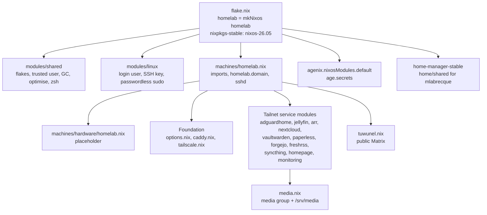
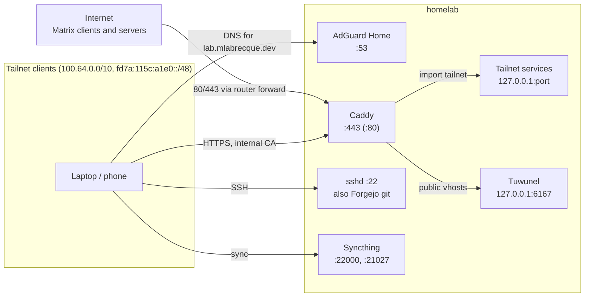

# Architecture

How the homelab configuration is assembled, and how the running services fit
together.

## Build composition

`flake.nix` builds the homelab with `mkNixos "homelab"`. The argument selects
`machines/homelab.nix`; `mkNixos` adds the layers every NixOS machine shares.

Every module receives the specialArgs `self`, `inputs`, `machine`,
`username` (`mlabrecque`), and `homeDirectory` (`/home/mlabrecque`).
`configDir` does not exist on NixOS.

There is no auto-import: a file in `modules/server/` does nothing until
`machines/homelab.nix` imports it. `immich.nix` exists but is not imported
(see [open-items.md](open-items.md#immich)).

## Module roles

| Role | Modules | Provides |
| --- | --- | --- |
| Options | `options.nix` | `homelab.domain`, `homelab.dataRoot`, `homelab.tailscaleIPv4` |
| Ingress | `caddy.nix` | Caddy, the `(tailnet)` snippet, TCP 443 on `tailscale0` |
| Overlay network | `tailscale.nix` | `tailscaled`, Tailscale's UDP port |
| DNS | `adguardhome.nix` | Tailnet DNS, rewrites for the lab domain |
| Shared library | `media.nix` | `media` group, `/srv/media` tree; imported by `jellyfin.nix` and `arr.nix`, not by the machine |
| Services | `jellyfin.nix`, `arr.nix`, `nextcloud.nix`, `vaultwarden.nix`, `paperless.nix`, `forgejo.nix`, `freshrss.nix`, `syncthing.nix`, `monitoring.nix` | One service (or one family) each, plus its vhost |
| Dashboard | `homepage.nix` | Links to every tailnet service at the apex domain |
| Public | `tuwunel.nix` | Matrix homeserver, public vhosts, TCP 80/443 on all interfaces |

### Options (`options.nix`)

| Option | Type | Default | Set in | Read by |
| --- | --- | --- | --- | --- |
| `homelab.domain` | string | none (required) | `machines/homelab.nix`: `lab.mlabrecque.dev` | every service module except `tuwunel.nix` |
| `homelab.dataRoot` | string | `/srv` | not overridden | `media.nix`, `arr.nix`, `nextcloud.nix`, `paperless.nix`, `syncthing.nix`, `immich.nix` |
| `homelab.tailscaleIPv4` | null or string | `null` | commented out in `machines/homelab.nix` | `adguardhome.nix` |

`tuwunel.nix` hard-codes `mlabrecque.dev`; it does not read `homelab.*`,
which is why the VPS can import it without `options.nix`.

### Dependencies between modules

A module that reads `config.homelab.*` needs `options.nix`. A vhost that uses
`import tailnet` needs `caddy.nix`, which defines the snippet. Caddy fails to
load its config if the snippet is missing.

| Module | Needs `options.nix` | Needs `caddy.nix` | Imports | Secrets |
| --- | --- | --- | --- | --- |
| `adguardhome.nix` | yes | yes | | |
| `jellyfin.nix` | yes | yes | `media.nix` | |
| `arr.nix` | yes | yes | `media.nix` | |
| `nextcloud.nix` | yes | yes | | `nextcloud-admin` |
| `vaultwarden.nix` | yes | yes | | `vaultwarden-env` |
| `paperless.nix` | yes | yes | | `paperless-admin` |
| `forgejo.nix` | yes | yes | | |
| `freshrss.nix` | yes | yes | | `freshrss-admin` |
| `syncthing.nix` | yes | yes | | |
| `homepage.nix` | yes | yes | | |
| `monitoring.nix` | yes | yes | | `grafana-admin`, `grafana-secret-key` |
| `tuwunel.nix` | no | no (enables Caddy itself) | | |

## Server module pattern

Each service module follows the same contract:

1. Enable the upstream NixOS service.
2. Bind it to `127.0.0.1` (Caddy is the only entry point).
3. Add `services.caddy.virtualHosts."<name>.${homelab.domain}"` whose config
   starts with `import tailnet`, then `reverse_proxy 127.0.0.1:<port>`.
4. Open extra ports only on `networking.firewall.interfaces.tailscale0`.

Deviations, and why:

| Module | Deviation | Reason |
| --- | --- | --- |
| `freshrss.nix` | Module writes its own Caddy vhost (`webserver = "caddy"`, PHP-FPM); the repo prepends `import tailnet` with `lib.mkBefore` | FreshRSS is PHP; no HTTP port to proxy |
| `nextcloud.nix` | Upstream module serves through nginx; nginx is moved to `127.0.0.1:8081` and Caddy proxies to it | Keeps nginx off Caddy's 80/443 |
| `syncthing.nix` | `header_up Host {upstream_hostport}` | The GUI rejects non-localhost `Host` headers |
| `homepage.nix` | Vhost is the apex `lab.mlabrecque.dev`; `allowedHosts` set to it | Dashboard lives at the bare domain |
| `adguardhome.nix`, `syncthing.nix` | Open ports on `tailscale0` | DNS (53) and Syncthing sync/discovery are not HTTP |
| `tuwunel.nix` | No `import tailnet`; public ACME certs; opens 80/443 on all interfaces | Matrix must federate |
| `jellyfin.nix`, `arr.nix`, `homepage.nix` | No bind address set; apps listen on all interfaces | Not enforced yet; firewall keeps the ports closed ([open-items.md](open-items.md#known-issues)) |

## Runtime topology

Request path for a tailnet service, e.g. `https://vault.lab.mlabrecque.dev`:

1. The client asks Tailscale's resolver; split DNS forwards `lab.mlabrecque.dev`
   names to AdGuard on the homelab.
2. AdGuard rewrites `*.lab.mlabrecque.dev` to `homelab.tailscaleIPv4`.
3. The client connects to that address on 443 over WireGuard.
4. Caddy matches the vhost, serves a certificate from its internal CA, checks
   the source is a Tailscale address, and proxies to `127.0.0.1:8222`.

Details: [network.md](network.md).

## Internal connections

Connections inside the host, all over loopback or Unix sockets.

| From | To | How | Defined in |
| --- | --- | --- | --- |
| Caddy | every tailnet service | `reverse_proxy 127.0.0.1:<port>` | each service module |
| Caddy | FreshRSS | PHP-FPM socket (`phpfpm-freshrss`) | upstream FreshRSS module |
| Caddy | nginx `127.0.0.1:8081` → `phpfpm-nextcloud` | reverse proxy, then FastCGI | `nextcloud.nix`, upstream module |
| Nextcloud | PostgreSQL 17 (database `nextcloud`) | local socket, `database.createLocally` | `nextcloud.nix` |
| Nextcloud | Redis (`redis-nextcloud`) | enabled by the upstream module | upstream module |
| Paperless | Redis (`redis-paperless`) | task queue | upstream module |
| Grafana | Prometheus `127.0.0.1:9090` | provisioned default datasource | `monitoring.nix` |
| Prometheus | node exporter `127.0.0.1:9100` | scrape job `node` | `monitoring.nix` |
| Sonarr, Radarr, Bazarr, qBittorrent, Jellyfin | `/srv/media` | shared `media` group | `media.nix`, `arr.nix`, `jellyfin.nix` |
| Forgejo | sshd | Git over SSH as the Forgejo user | `forgejo.nix` |

Application-level wiring is **not** in the repo and is done in each web UI:
Prowlarr → Sonarr/Radarr (indexers), Sonarr/Radarr → qBittorrent (download
client), Bazarr → Sonarr/Radarr, Jellyfin libraries. Use
`http://127.0.0.1:<port>` for these, since everything runs on one host. See
[services.md](services.md#media-and-downloads).
