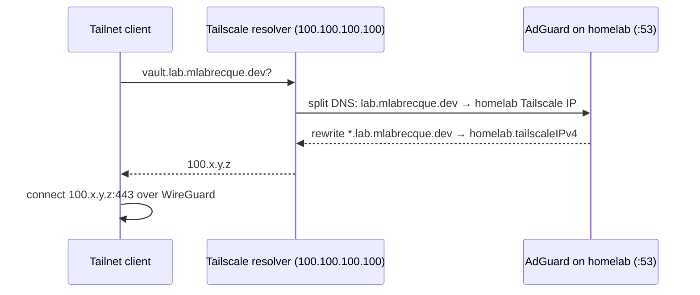

# Network and access

The homelab has two audiences: tailnet devices, which reach every service, and
the public internet, which reaches only Matrix.

## Names

| Name | Served by | Audience | Certificate |
| --- | --- | --- | --- |
| `lab.mlabrecque.dev` | Homepage | tailnet | Caddy internal CA |
| `<name>.lab.mlabrecque.dev` | each service (see [services.md](services.md)) | tailnet | Caddy internal CA |
| `matrix.mlabrecque.dev` | Tuwunel (`/_matrix/*`) | public | public ACME (Caddy default) |
| `mlabrecque.dev` | Tuwunel (`/.well-known/matrix/*` only) | public | public ACME (Caddy default) |

The `lab.mlabrecque.dev` names resolve only through the tailnet (split DNS to
AdGuard). The repo does not manage public DNS; the Matrix names need public
records pointing at the homelab only after the cutover
([open-items.md](open-items.md#matrix-cutover-vps--homelab)).

## Tailscale

`modules/server/tailscale.nix`:

- `services.tailscale.enable = true`, unit `tailscaled`.
- `openFirewall = true` opens Tailscale's UDP port (`41641`) on all interfaces
  so peers can connect directly instead of through DERP relays.
- `useRoutingFeatures` is left at `none`: the homelab is not a subnet router or
  exit node.

Joining is manual and happens once: `sudo tailscale up`, then
`tailscale ip -4` for the address that goes into `homelab.tailscaleIPv4`.
Consider disabling key expiry for the homelab in the admin console so the
server does not drop off the tailnet when its node key expires.

## DNS



### AdGuard Home (`modules/server/adguardhome.nix`)

| Setting | Value | Effect |
| --- | --- | --- |
| Web UI | `127.0.0.1:3000` | Proxied at `https://adguard.lab.mlabrecque.dev` |
| `dns.bind_hosts` | `0.0.0.0` | Listens everywhere; firewall opens 53 only on `tailscale0` |
| `mutableSettings` | `true` | Web UI changes persist; repo settings are merged in on every start |
| `filtering.rewrites` | `lab.mlabrecque.dev` and `*.lab.mlabrecque.dev` → `homelab.tailscaleIPv4` | Present only when the option is set; empty today |

Upstream resolvers, blocklists, and UI users are not set in the repo; configure
them in the web UI (they persist because settings are mutable).

### Tailscale admin console

Add a split DNS nameserver: **DNS → Nameservers → Add nameserver → Custom**,
the homelab's Tailscale IP, restricted to domain `lab.mlabrecque.dev`.

With split DNS only, AdGuard answers just the lab names; other lookups do not
go through it, so ad blocking does not apply to them. To filter all tailnet
DNS, also set the homelab as a global nameserver (with "Override local DNS").
That makes every tailnet device depend on the homelab for DNS.

## Caddy and TLS

`modules/server/caddy.nix` enables Caddy (unit `caddy`, state `/var/lib/caddy`)
and defines the `tailnet` snippet:

```caddy
(tailnet) {
  tls internal
  @outside not remote_ip 100.64.0.0/10 fd7a:115c:a1e0::/48
  abort @outside
}
```

- `tls internal`: certificates come from Caddy's own CA, so no public DNS or
  ACME is needed for lab names.
- `abort @outside`: connections from outside Tailscale's IPv4 CGNAT range and
  IPv6 ULA range are closed without a response. Caddy listens on 443 on every
  interface (Matrix needs it public), so this check is what keeps tailnet vhosts
  private, not the firewall.
- Consequence: a LAN device that is not on Tailscale is refused even if it
  reaches the homelab's LAN address. Every client needs Tailscale.

The root certificate clients must trust:

    /var/lib/caddy/.local/share/caddy/pki/authorities/local/root.crt

Client steps are in [setup.md](setup.md#9-client-onboarding). The CA lives in
`/var/lib/caddy`; losing that directory means re-trusting a new root on every
device ([storage.md](storage.md#backup-inventory)).

The Matrix vhosts (`tuwunel.nix`) have no `tls` directive, so Caddy uses its
default automatic HTTPS with public ACME. Issuance needs public DNS for both
names pointing at this host and inbound 80/443. No ACME email is set.

## Firewall

Evaluated from `networking.firewall`:

| Interface | TCP | UDP | Opened by |
| --- | --- | --- | --- |
| all | `80`, `443` | | `tuwunel.nix` (Matrix; router must forward) |
| all | | `41641` | `tailscale.nix` (`openFirewall`) |
| `tailscale0` | `22` | | `machines/homelab.nix` (sshd, `openFirewall = false`) |
| `tailscale0` | `53` | `53` | `adguardhome.nix` |
| `tailscale0` | `443` | | `caddy.nix` |
| `tailscale0` | `22000` | `22000`, `21027` | `syncthing.nix` |

Without `tuwunel.nix`, 443 would be reachable only on `tailscale0` and 80 not
at all.

## SSH

`machines/homelab.nix`:

- `services.openssh.enable = true`, `PasswordAuthentication = false`.
- `openFirewall = false`; port 22 opened only on `tailscale0`. SSH over the LAN
  or internet is blocked.
- Authorized key for `mlabrecque` comes from `modules/linux/default.nix` (the
  Mac's key; a `TODO` notes it should move to agenix). Sudo needs no password.

Forgejo serves Git over this same sshd. See
[services.md](services.md#forgejo).

## Public exposure summary

| Exposed | Port | What answers |
| --- | --- | --- |
| Internet | TCP 80 | Caddy: ACME HTTP challenges, HTTP → HTTPS redirects |
| Internet | TCP 443 | Caddy: Matrix vhosts; every other SNI is aborted by `tailnet` |
| Internet | UDP 41641 | Tailscale (WireGuard, authenticated) |

The router forwards only matter for 80/443, and only once Matrix moves to the
homelab.
