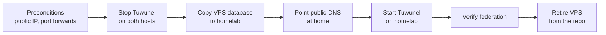

# Open items

## Before the first deploy

- [ ] Replace `machines/hardware/homelab.nix` (placeholder) with
      `nixos-generate-config` output.
- [ ] Set a boot loader, `system.stateVersion`, and `networking.hostName` in
      `machines/homelab.nix`.
- [ ] `sudo tailscale up`; set `homelab.tailscaleIPv4`; add split DNS in the
      Tailscale admin console.
- [ ] Add the homelab host key to `secrets/secrets.nix`, encrypt the six
      secrets, uncomment the `age.secrets` blocks.
- [ ] Optionally add `homelab` to `checks.x86_64-linux` in `flake.nix` once
      the hardware file is real.

Procedure: [setup.md](setup.md).

## Known issues

- **No backups.** Nothing in the repo backs up `/srv` or service state. What
  needs covering: [storage.md](storage.md#backup-inventory); how a restore
  would go: [RECOVERY.md](RECOVERY.md).
- **Forgejo SSH user.** `forgejo.nix`'s comment documents
  `git@git.lab.mlabrecque.dev:owner/repo.git`, but neither `services.forgejo.user`
  nor `settings.server.SSH_USER` is set, so the SSH user is `forgejo`. Either
  fix the comment or set the user to `git`.
- **Not every service binds to loopback.** Jellyfin, Sonarr, Radarr, Prowlarr,
  Bazarr, qBittorrent (WebUI), and Homepage keep their app defaults and listen
  on all interfaces. The firewall keeps them unreachable, but the
  [module pattern](architecture.md#server-module-pattern) is not met.
- **qBittorrent peer port closed.** The BitTorrent listening port is not opened
  or forwarded, so there are no incoming peer connections.
- **Open admin surfaces on the tailnet.** The AdGuard and Syncthing UIs have no
  credentials set in the repo, Vaultwarden signups and Forgejo registration are
  not disabled, and Homepage has no auth. Anyone on the tailnet can reach them.
- **Media permissions.** Services create files with their own umask; group write
  on `/srv/media` content is not guaranteed
  ([storage.md](storage.md#media-library)).
- **SSH key hard-coded.** `modules/linux/default.nix` carries the authorized
  key inline with a `TODO` to move it to agenix.
- **Duplicate Matrix server.** Both the homelab and the VPS import
  `tuwunel.nix` with `server_name = mlabrecque.dev`. Until the cutover, the
  homelab runs an empty instance and Caddy retries ACME for the Matrix names.
- **No dashboards or alerting.** Grafana has only the Prometheus datasource;
  only the node exporter is scraped.

## Immich

`modules/server/immich.nix` is written but not imported: nixos-26.05 marks
Immich 2.7.5 insecure with no further 2.x updates; 3.x ships with NixOS 26.11.

When the homelab moves to 26.11:

1. Add `../modules/server/immich.nix` to `machines/homelab.nix`.
2. Add `(link "Immich" "immich")` to the Media group in `homepage.nix`.
3. Add it to [services.md](services.md) and `/srv/photos` to
   [storage.md](storage.md).

The module serves `immich.lab.mlabrecque.dev` and stores photos in
`/srv/photos`.

## Matrix cutover (VPS → homelab)

Owner decision: the homelab replaces the VPS as the Matrix homeserver, and the
VPS is retired afterwards. **Not executed.** The steps below follow from the
repo; public DNS, the router, and the ISP are outside it.

### Preconditions

- The home connection has a reachable public IPv4 (not CGNAT) and the ISP
  allows inbound 80/443. If the IP is dynamic, a DDNS updater is needed; the
  repo has none.
- The router forwards TCP 80 and 443 to the homelab's LAN address.
- The homelab is installed and stable ([setup.md](setup.md)).
- A day ahead, lower the TTL of the public records for `matrix.mlabrecque.dev`
  and `mlabrecque.dev`.

### Steps

1. Stop Tuwunel on the homelab and discard its empty database (it was created
   on first start and must not be merged):

       sudo systemctl stop tuwunel
       sudo rm -rf /var/lib/private/tuwunel

2. Stop Tuwunel on the VPS so the database is consistent:

       sudo systemctl stop tuwunel

3. Copy the VPS database over the tailnet. It includes the server signing key,
   which keeps the federation identity:

       # on the VPS
       sudo tar -C /var/lib/private -czf - tuwunel \
         | ssh mlabrecque@<homelab-tailscale-ip> 'sudo tar -C /var/lib/private -xzf -'

   Both hosts run Tuwunel with `DynamicUser`; systemd re-owns the state
   directory on the next start.

4. Update public DNS: `A` (and `AAAA` if the homelab has public IPv6; the repo
   configures none) for `matrix.mlabrecque.dev` and `mlabrecque.dev` → the home
   public IP. Remove the VPS's `AAAA` records if there is no replacement.
5. Start Tuwunel on the homelab once DNS resolves to it; Caddy obtains the
   certificates:

       sudo systemctl start tuwunel
       journalctl -u caddy -u tuwunel -f

6. Verify:

       curl https://mlabrecque.dev/.well-known/matrix/server
       curl https://matrix.mlabrecque.dev/_matrix/client/versions

   and run the domain through <https://federationtester.matrix.org>. Log in
   with an existing account from a client.

7. Keep the VPS stopped but intact for a while as a fallback.

### Retiring the VPS in the repo

- Remove `ovh-vps` from `nixosConfigurations` and `checks` in `flake.nix`.
- Delete `machines/vps.nix`, `machines/hardware/ovh-vps.nix`,
  `machines/hardware/ovh-vps-disk.nix`.
- Remove the `vps-sync` alias from `home/darwin/shell.nix`.
- Drop the VPS host key from `secrets/secrets.nix` if it was ever added, and
  rekey.
- Check whether `disko` is still used; remove the input if not.
- Update the comment on the `tuwunel.nix` import in `machines/homelab.nix`.
- Delete `documentation/ovh-vps.md`; update `README.md`, `AGENTS.md`, and
  `documentation/monorepo-structure.md`.
