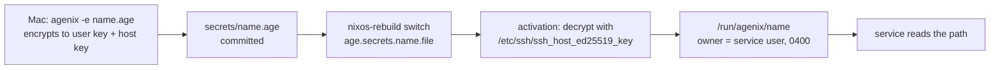

# Secrets

Secrets use [agenix](https://github.com/ryantm/agenix). Encrypted files live in
`secrets/<name>.age`; `secrets/secrets.nix` lists who can decrypt each one. The
flake does not import `secrets.nix`; only the `agenix` CLI reads it.

## How it works on the homelab



- `agenix.nixosModules.default` is added by `mkNixos`, so `age.secrets` is
  available on every NixOS machine.
- Decryption uses the machine's SSH host key, which exists only after
  installation. That is why no homelab secret can be encrypted yet.
- Modules reference `/run/agenix/<name>` as a literal path, so the config
  evaluates even when the `age.secrets` block is commented out. The service then
  fails or starts without credentials at runtime.

## Current state

`secrets/secrets.nix` lists only the Mac user key (`mlabrecque`), and the only
encrypted file is `github-email.age` (for the Mac). The homelab's host key is
not a recipient, and every homelab `age.secrets` block is commented out.

## Secrets used by the homelab

| Secret | Consumer | Owner | Content | Applied |
| --- | --- | --- | --- | --- |
| `nextcloud-admin` | Nextcloud `config.adminpassFile` | `nextcloud` | admin (`root`) password | at initial setup only |
| `vaultwarden-env` | Vaultwarden `environmentFile` | `vaultwarden` | `ADMIN_TOKEN=<token>` | every start |
| `paperless-admin` | Paperless `passwordFile` | `paperless` | superuser (`admin`) password | by the module |
| `freshrss-admin` | FreshRSS `passwordFile` | `freshrss` | `admin` password | by the module |
| `grafana-admin` | Grafana `security.admin_password` | `grafana` | `admin` password | when the admin user is first created |
| `grafana-secret-key` | Grafana `security.secret_key` | `grafana` | random key (e.g. `openssl rand -base64 32`) | every start; do not rotate casually, it encrypts stored datasource secrets |

The declarations are already written, commented out, at the top of
`nextcloud.nix`, `vaultwarden.nix`, `paperless.nix`, `freshrss.nix`, and
`monitoring.nix`.

## Enabling the homelab's secrets

1. On the installed homelab, read its host key:

       cat /etc/ssh/ssh_host_ed25519_key.pub

   (or from the Mac over the tailnet: `ssh-keyscan -t ed25519 <tailscale-ip>`).
2. Add it to `secrets/secrets.nix` and list it for each homelab secret:

   ```nix
   let
     mlabrecque = "ssh-ed25519 AAAA... mheenan@Matts-MacBook-Air.local";
     homelab = "ssh-ed25519 AAAA... root@homelab";
     users = [ mlabrecque ];
   in
   {
     "github-email.age".publicKeys = [ mlabrecque ];
     "nextcloud-admin.age".publicKeys = users ++ [ homelab ];
     "vaultwarden-env.age".publicKeys = users ++ [ homelab ];
     # paperless-admin, freshrss-admin, grafana-admin, grafana-secret-key
   }
   ```

3. Create each file from `secrets/`: `agenix -e <name>.age`. After changing
   recipients of an existing file, re-encrypt with `agenix -r`.
4. Uncomment the matching `age.secrets.<name>` block. Nextcloud's block is
   already written with `owner = "nextcloud"`.
5. `git add` the new `.age` files (flakes only see tracked files), commit, and
   rebuild on the homelab.

Creating and encrypting secrets is the owner's step; never put secret values in
`.nix` files.

## Rotating

- Edit with `agenix -e <name>.age`, commit, rebuild.
- Values applied "at initial setup only" or "when first created" do not change
  the running service's credential; change it in the app as well (Nextcloud:
  `nextcloud-occ user:resetpassword root`; Grafana: UI or
  `grafana cli admin reset-admin-password`).
- If the host key changes (reinstall without restoring it), add the new key and
  run `agenix -r`.
