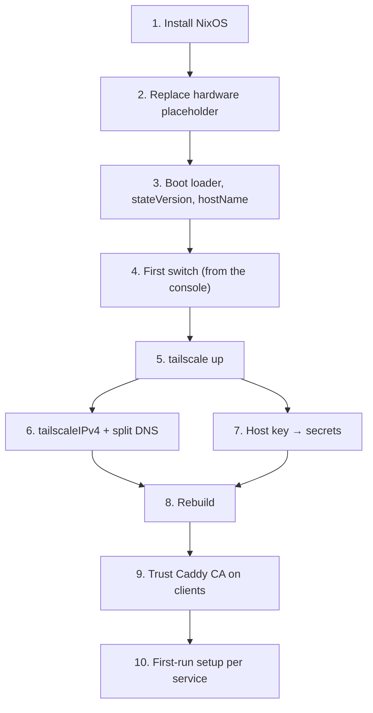

# Setup

First installation of the homelab, then onboarding client devices. Steps are
ordered by dependency: the host key must exist before secrets, Tailscale must
be up before DNS, and SSH only works over Tailscale once this config is active.
Rebuilding after a failure is in [RECOVERY.md](RECOVERY.md).



## 1. Install NixOS

The repo does not define an install procedure. Install NixOS 26.05 from the
official ISO with whatever disk layout suits the hardware; put the bulk storage
where `/srv` will live. (`disko` is a flake input, used by the VPS, if you want
the layout declared in the repo.)

## 2. Replace the hardware placeholder

On the homelab:

    nixos-generate-config --show-hardware-config

Replace `machines/hardware/homelab.nix` with the output. The placeholder's
comment says not to deploy with it: its root filesystem is a dummy label and
GRUB has no device.

## 3. Per-host values in `machines/homelab.nix`

The generated hardware file has no boot loader, and the machine file sets no
`stateVersion` or hostname. Add, for example on UEFI:

```nix
boot.loader.systemd-boot.enable = true;
boot.loader.efi.canTouchEfiVariables = true;

networking.hostName = "homelab";

# The release the machine was installed with. Never change it afterwards.
system.stateVersion = "26.05";
```

Leave `stateVersion` alone after the first switch, even when moving to a newer
NixOS release.

## 4. First switch, from the console

Once this config is active, sshd accepts connections only on `tailscale0`, and
the homelab is not on the tailnet yet. Do the first switch at the physical
console (or keep an already open SSH session; established connections survive,
new ones are refused until step 5).

At the console, log in as `root` with the password `nixos-install` asked for
(`users.mutableUsers` is at its default, so it persists). `mlabrecque` has no
password and can only log in with its SSH key.

Get the checkout onto the machine (the repo does not define a path), then:

    sudo nixos-rebuild switch --flake .#homelab

Expected on this first run:

- Services that read `/run/agenix/*` (Nextcloud, Vaultwarden, Paperless,
  FreshRSS, Grafana) fail or start without an admin; secrets come in step 7.
- Caddy logs ACME errors for `matrix.mlabrecque.dev` and `mlabrecque.dev`,
  whose public DNS still points at the VPS. Harmless until the cutover.

## 5. Join the tailnet

    sudo tailscale up
    tailscale ip -4

Approve the node in the admin console if required, and consider disabling its
key expiry. From here on, SSH from the Mac over the tailnet:
`ssh mlabrecque@<tailscale-ip>` (or the MagicDNS name).

## 6. DNS

1. Set `homelab.tailscaleIPv4` in `machines/homelab.nix` to the address from
   step 5 (the line is commented out there).
2. In the Tailscale admin console, add a split DNS nameserver: the homelab's
   Tailscale IP, restricted to `lab.mlabrecque.dev`
   ([network.md](network.md#tailscale-admin-console)).

## 7. Secrets

Follow [secrets.md](secrets.md#enabling-the-homelabs-secrets): add the host
key to `secrets/secrets.nix`, run `agenix -e` for each secret, uncomment the
`age.secrets` blocks.

## 8. Rebuild

Commit steps 6–7, pull on the homelab, and switch again. Check:

    systemctl --failed
    dig @<tailscale-ip> vault.lab.mlabrecque.dev   # from a tailnet device

## 9. Client onboarding

Every device that uses the homelab needs:

1. **Tailscale**, logged into the same tailnet. Without it, Caddy aborts the
   connection even on the home LAN.
2. **"Use Tailscale DNS"** enabled (the default), so split DNS resolves
   `*.lab.mlabrecque.dev`.
3. **Caddy's root certificate trusted.** Copy it off the homelab:

       ssh mlabrecque@<tailscale-ip> \
         sudo cat /var/lib/caddy/.local/share/caddy/pki/authorities/local/root.crt \
         > caddy-root.crt

   | Platform | Trust it |
   | --- | --- |
   | macOS | `sudo security add-trusted-cert -d -r trustRoot -k /Library/Keychains/System.keychain caddy-root.crt` |
   | iOS / iPadOS | AirDrop or mail the file, install the profile in Settings, then enable it under Settings → General → About → Certificate Trust Settings |
   | Android | Settings → Security → Encryption & credentials → Install a certificate → CA certificate |
   | NixOS | `security.pki.certificateFiles = [ ./caddy-root.crt ];` |
   | Firefox | Uses its own store unless `security.enterprise_roots.enabled` is on; otherwise import under Settings → Certificates |

4. For Syncthing peers, add the homelab using its Tailscale address
   (`tcp://<tailscale-ip>:22000`); sync ports are closed elsewhere.
5. For Forgejo over SSH, the device's key must be added in Forgejo's web UI.

Then open `https://lab.mlabrecque.dev`.

## 10. First-run setup per service

Admin accounts, Jellyfin libraries, and the *arr/qBittorrent wiring are done in
the web UIs. See [services.md](services.md#credentials-and-first-run) and
[services.md](services.md#media-and-downloads).

## Later: Matrix

Router port forwards (TCP 80/443) and public DNS changes belong to the Matrix
cutover, not the initial setup:
[open-items.md](open-items.md#matrix-cutover-vps--homelab).
